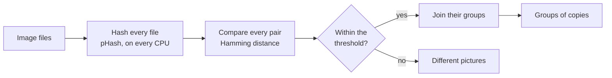

# Finding duplicate images

A checksum finds only the files that are the same byte for byte. A picture saved again as
JPEG, scaled down for the web or brightened a little is a different file with a different
checksum, and to anyone who looks at it the same picture. A perceptual hash gives such
copies hashes a few bits apart and unrelated pictures hashes about half the bits apart, so
finding them takes four steps: choose an algorithm, hash every file, compare the hashes,
and join the close ones into groups. This page goes through the four with one program that
does them all, and links each step to the page that measures it.



## Which algorithm

For photographs whose copies are recompressed, scaled, or changed in brightness, contrast or
gamma, pHash: of the nine algorithms it separates such copies from different photographs
best, and it is among the cheapest four
([Choosing an algorithm](../theory/choosing.md#four-questions)). Other copies call for
another hash:

- **Cropped copies**: Radial, which a 5 % crop moves least of all.
- **Copies turned a quarter or mirrored**: no hash of the layout survives them; the two
  color hashes do not see the turn.
- **A change of color that makes another picture**, such as one product in two colors:
  ColorHash beside a layout hash, since a gray hash barely notices a turned hue.
- **Flat shapes and patterns rather than photographs**: BMH, which separates those best.

The program below uses pHash. aHash, dHash and wHash are one flag away, as they are 64-bit
hashes compared the same way; a digest algorithm also needs its own comparison function
([Which function for which hash](../theory/comparing.md#which-function-for-which-hash)).

## Hashing the files

[`ph_hash_files()`](../api/batch.md#ph_hash_files) hashes every file on a pool of workers,
one per CPU when `threads` is 0, and stores each file's hash and status in its item. A
file that cannot be read or decoded fails alone, with its own status, and the others are
hashed as usual:

```c title="examples/find_duplicates.c"
--8<-- "examples/find_duplicates.c:hash"
```

[Hashing many files](batch.md) has the options this call leaves at their defaults: a
configuration for every file, progress, cancellation, the number of workers and the memory
each of them holds.

## Choosing the threshold

The threshold is the most bits two hashes of one picture may differ in. It is a property
of the collection more than of the algorithm. Here is the threshold that accepts 95 % of
the copies of each of the site's two corpora, 200 photographs and 24 synthetic images,
each copy one moderate edit, and the share of pairs of different images that lets through
as well:

--8<-- "docs/assets/generated/comparing/thresholds.md"

For pHash, the photographs' threshold lets no pair of different photographs through, while
the synthetic images, checkerboards, stripes, rings and discs, need a much looser one and
let many through. A collection's own threshold lies somewhere between, and the
program helps find it: run it with a loose threshold over images whose duplicates are
known, and read the pairs from the closest out. The distance at which the pairs stop being
the same picture is where the threshold goes.
[Measuring a threshold on your own collection](../theory/comparing.md#measuring-a-threshold-on-your-own-collection)
turns that into a share of copies accepted and a share of different pairs let through.

## Pairs within the threshold

Every pair of files is compared once, with
[`ph_hamming_distance()`](../api/compare.md#ph_hamming_distance), and a pair within the
threshold is kept; the pairs are printed closest first. A file that failed is left out of
every pair:

```c title="examples/find_duplicates.c"
--8<-- "examples/find_duplicates.c:pairs"
```

For $n$ files that is $n(n-1)/2$ comparisons, every one exact: no pair within the
threshold is missed.

## Groups of copies

A picture with three copies makes six pairs, and what a reader of the result wants is one
line per picture: the files that are copies of each other. Each pair joins the groups of
its two files, and the group of a file is found by following its parents to the group's
first file, a union-find:

```c title="examples/find_duplicates.c"
--8<-- "examples/find_duplicates.c:find"
```

```c title="examples/find_duplicates.c"
--8<-- "examples/find_duplicates.c:groups"
```

A group holds every file that a chain of pairs connects, and a chain can reach further
than the threshold: if A is within it of B and B of C, all three are one group, even when
A and C are further apart. That joins a picture with copies of copies, each edited a
little more, and it can join two different pictures through a file that sits between
them. The program prints each group's widest pair for that reason: a group whose widest
pair is well past the threshold is worth a look before a file of it is deleted. Which file
of a group to keep, such as the largest or the oldest, is the program's choice; the hashes
only say which files show the same picture.

## The program

```c title="examples/find_duplicates.c"
--8<-- "examples/find_duplicates.c"
```

```sh
cc find_duplicates.c -o find_duplicates $(pkg-config --cflags --libs libphash)
./find_duplicates 7 photos/*.jpg
```

The program prints every hash first, with the line that says what decided it: hashes
stored for a later search need it beside them ([Storing and searching
hashes](storing.md#what-a-hash-does-not-record)). Then come the pairs, closest first, and
the groups.

## Larger collections

Every pair of a collection grows with the square of its size: a hundred thousand files are
five billion pairs. [What a linear scan costs](storing.md#what-a-linear-scan-costs) has
the time of one comparison and what such a scan takes, measured. Past that size, two
changes keep the search short:

- **Compare each new file with the collection**, not the collection with itself: $n$
  comparisons for one new file, and the stored hashes are compared once each.
- **An index** finds the stored hashes within the threshold of a query without comparing
  it with all of them, and finds exactly the ones the scan would.
  [An index](storing.md#an-index) describes two, multi-index hashing and a BK-tree.

Files that are the same picture with nothing changed, the same hash to the bit, are
found without comparing pairs at all: sorted by hash, they sit next to each other.

## What it does not find

- **Copies edited more than the corpora's copies.** Each copy behind the thresholds is one
  moderate edit, a 2° rotation and a 5 % crop among them, and even at that strength the
  rotation and the crop are the copies a layout hash loses most often
  ([What counts as a copy](../theory/comparing.md#what-counts-as-a-copy)). How far each
  edit moves the hash as it grows is charted on each algorithm's page, for pHash under
  [What changes the hash](../theory/phash.md#what-changes-the-hash).
- **Quarter turns and mirror images**, as above: to a layout hash they are as far as an
  unrelated picture.
- **Anyone trying not to be found.** The hashes are deterministic and public, and a copy
  can be changed on purpose to land far from its original, or another picture to land
  near it. Finding duplicates in a collection you control is what they are for;
  [What a perceptual hash is not](../theory/perceptual-hashing.md#what-a-perceptual-hash-is-not)
  has the reasons and the alternatives.

From Python, [python-libphash](https://gudoshnikovn.github.io/python-libphash/) calls the
same library.
